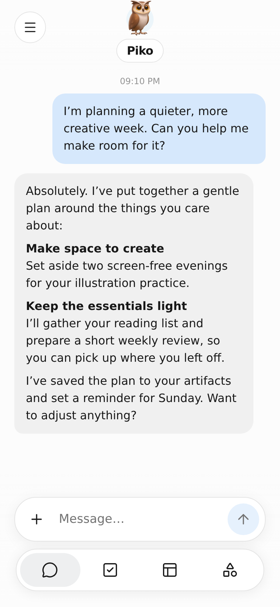
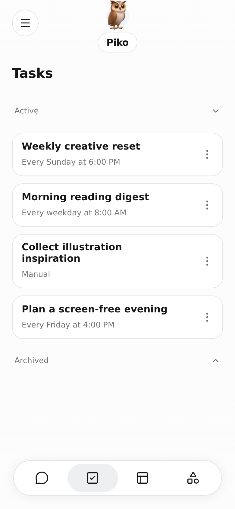
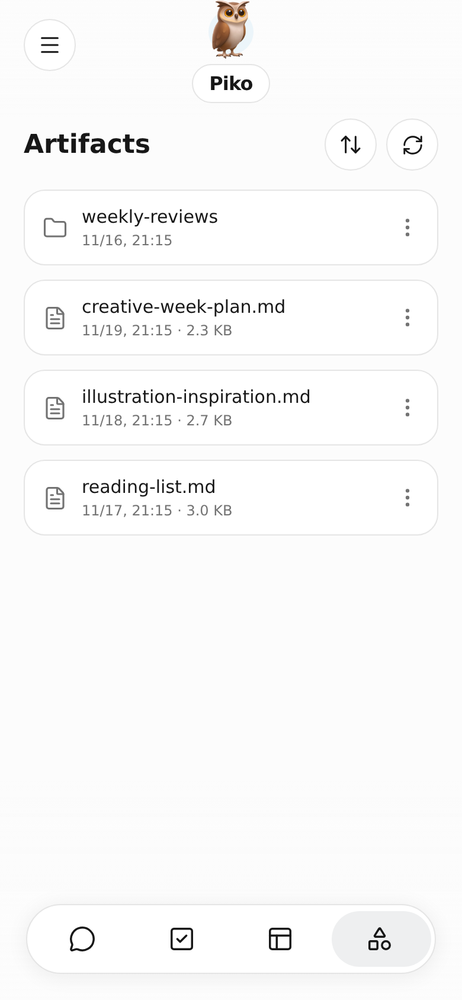

# Piko

[中文](README.zh-CN.md) | English

**A little more room for everyday life. Powered by Pi Durable.**

Piko is a local-first personal assistant. Through an ongoing conversation, it helps you think, organize work, and keep useful results in your own workspace.

## Why Piko?

- **Your choice of where to chat**: Use Piko on the web or through Telegram, with independent side chats to give different topics their own space.
- **Keep talking while work gets done**: Hand time-consuming work to background subagents and hear back when it's done, without watching a progress bar or putting your conversation on hold.
- **Ask once. Let it run on schedule.** Create one-off or recurring tasks that keep their execution status and past results—not just reminders that tell you it's time to do the work.
- **Discover without having to ask**: Personalized Posts draw on your interests and context to bring you things worth reading and discussing.
- **Keep what you create**: Articles, reports, and other finished work stay together in Artifacts, ready to browse, download, and reuse.
- **Go beyond the chat box**: Skills, built-in web search and extraction, and configurable MCP tools turn answers into action.
- **Less repetition, more continuity**: Daily notes, long-term memory, and conversation search help Piko build on past discussions instead of making you explain the background again.

## Screenshots

<p align="center">
  
  
  
  
</p>

*Screenshots use fictional example data.*

## Development

The frontend uses Expo / React Native and the backend uses Bun. The agent runtime is powered by pi-durable, with model access through pi-ai. With Bun 1.4+ and Node.js installed, run from the repository root:

```bash
bun install --frozen-lockfile
bun install --cwd apps/mobile --frozen-lockfile
bun run dev:web
```

The development command starts the API listening on `0.0.0.0:8787` and Expo Web at `localhost:8081`. On first launch, Piko initializes its configuration and workspace under `~/.piko`; [configure a model](docs/guides/configuration.md) before sending messages.

```bash
bun run typecheck
bun run build:web
```

See the [documentation index](docs/README.en.md) for deployment, configuration, and backups.

## Status and security

Piko is under active development; features and data formats may change. iOS and Android have not been comprehensively tested on devices, and there are no published mobile releases.

**Set `PIKO_ACCESS_KEY` in the private `PIKO_HOME/config/.env` before starting.** File and shell tools use the backend account's permissions, and the workspace is not a sandbox. The server listens on all IPv4 interfaces by default. HTTP does not encrypt credentials or content; use HTTPS or a trusted network for remote access.

Configuration, conversation data, attachments, and the default workspace live under `~/.piko`. Keep credentials private and [back up your data](docs/guides/storage.md).

## License

[MIT](LICENSE)
