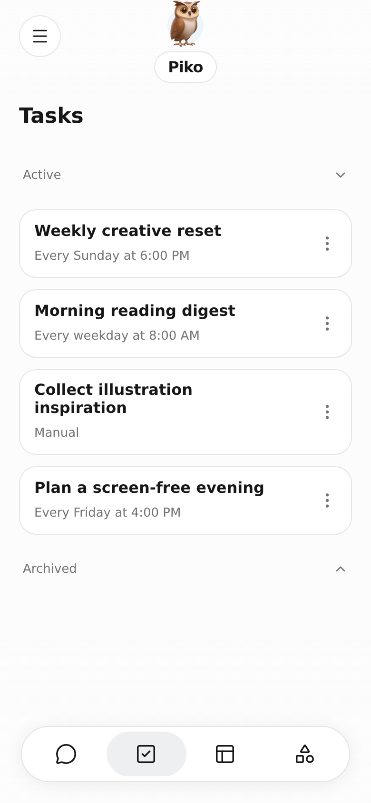
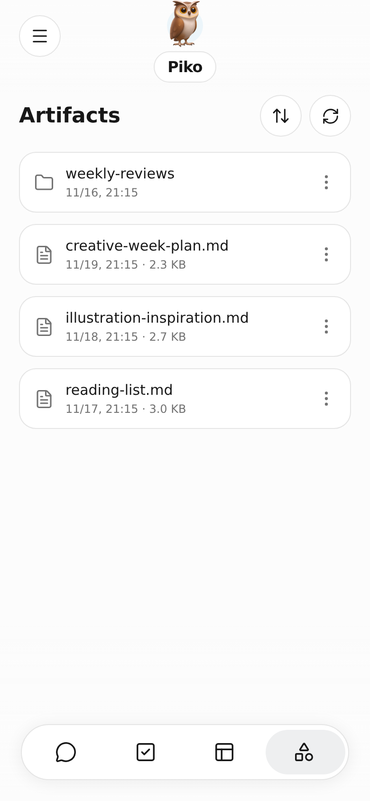

# Piko

中文 | [English](README.md)

**给日常留一点空间。由 Pi Durable 驱动。**

Piko 是一个本地优先的个人助理。通过持续的对话，它帮助你思考、安排工作，并把值得保留的成果放在自己的工作区里。

## 为什么用 Piko？

- **换个入口，继续聊**：在 Web 或 Telegram 中使用，也能开启独立旁聊，让不同话题各有空间。
- **工作在后台，对话不等待**：耗时任务交给子 Agent，完成后再向你汇报，不必守着进度，也不用停下正在聊的话题。
- **交代一次，让它按时去做**：支持一次性和定时任务，保留执行状态与历史结果，不只是到点发一句提醒。
- **不只回答，也带来发现**：Posts 结合你的兴趣和上下文，主动带来值得读、值得继续聊的内容。
- **做完的成果，随时找得到**：文章、报告等正式产物集中留存，方便浏览、下载和再次使用。
- **能力不止于聊天框**：通过技能、内置搜索与网页提取，以及可配置的 MCP 工具，把回答延伸为实际行动。
- **少重复背景，多接着往下聊**：当天记忆、长期记忆和会话搜索相互补充，让过去的交流成为下一次对话的起点。

## 界面截图

<p align="center">
  
  
  
  
</p>

*截图使用虚构的示例数据。*

## 开发

前端使用 Expo / React Native，后端使用 Bun；Agent 运行时基于 pi-durable，模型接入使用 pi-ai。需要 Bun 1.4+ 和 Node.js，在仓库根目录运行：

```bash
bun install --frozen-lockfile
bun install --cwd apps/mobile --frozen-lockfile
bun run dev:web
```

开发服务默认启动 API（监听 `0.0.0.0:8787`）和 Expo Web（`localhost:8081`）。首次启动会在 `~/.piko` 初始化配置和工作区；发送消息前需[配置模型](docs/guides/configuration.zh-CN.md)。

```bash
bun run typecheck
bun run build:web
```

更多运行、配置和备份说明见[文档索引](docs/README.md)。

## 状态与安全

Piko 仍在开发中，功能和数据格式可能变化；iOS / Android 尚未全面真机验证，也没有正式发布的移动端安装包。

**启动前须在私有的 `PIKO_HOME/config/.env` 中设置 `PIKO_ACCESS_KEY`。** 文件和命令工具使用后端账户的权限，工作区不是沙箱。服务默认监听所有 IPv4 网络接口；HTTP 不加密凭据和内容，远程访问应使用 HTTPS 或受信网络。

配置、会话数据、附件和默认工作区位于 `~/.piko`；请保护凭据并定期[备份数据](docs/guides/storage.zh-CN.md)。

## 许可证

[MIT](LICENSE)
