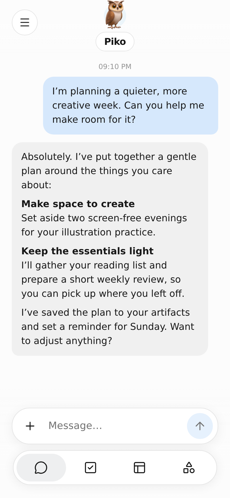

# Piko

中文 | [English](README.md)

**给日常留一点空间。由 Pi Durable 驱动。**

Piko 是一个本地优先的个人助理。通过持续的对话，它帮助你思考、安排工作，并把值得保留的成果放在自己的工作区里。

## 主要功能

- **Chat**：持久主会话与独立旁聊，支持流式回复、附件和可选的 Telegram 私聊。
- **Tasks**：通过聊天交办后台工作，或创建可手动、一次性及定时运行的任务。
- **Posts**：根据用户上下文自动或手动生成个性化内容。
- **Artifacts**：浏览和下载助手保存的正式成果。
- **工作区与工具**：文件、记忆、技能、网页搜索与提取，以及可配置的 MCP 工具。

## 界面截图

<p align="center">
  
  
  
  
</p>

*截图使用虚构的示例数据。*

## 开发

前端使用 Expo / React Native，后端使用 Bun；Agent 运行时基于 pi-durable，模型接入使用 pi-ai。需要 Bun 1.4+ 和 Node.js，在仓库根目录运行：

```bash
bun install --frozen-lockfile
bun install --cwd apps/mobile --frozen-lockfile
bun run dev:web
```

开发服务默认启动 API（`127.0.0.1:8787`）和 Expo Web（`localhost:8081`）。首次启动会在 `~/.piko` 初始化配置和工作区；发送消息前需[配置模型](docs/guides/configuration.zh-CN.md)。

```bash
bun run typecheck
bun run build:web
```

更多运行、配置和备份说明见[文档索引](docs/README.md)。

## 状态与安全

Piko 仍在开发中，功能和数据格式可能变化；iOS / Android 尚未全面真机验证，也没有正式发布的移动端安装包。

**当前 API 没有登录认证，文件和命令工具使用后端账户的权限，工作区不是沙箱。** 服务默认仅监听本机；不要直接暴露到不可信网络。需要远程访问时，应使用认证代理保护 Web、API 和 SSE，并阻止绕过代理直连后端。

配置、会话数据、附件和默认工作区位于 `~/.piko`；请保护凭据并定期[备份数据](docs/guides/storage.zh-CN.md)。

## 许可证

[MIT](LICENSE)
